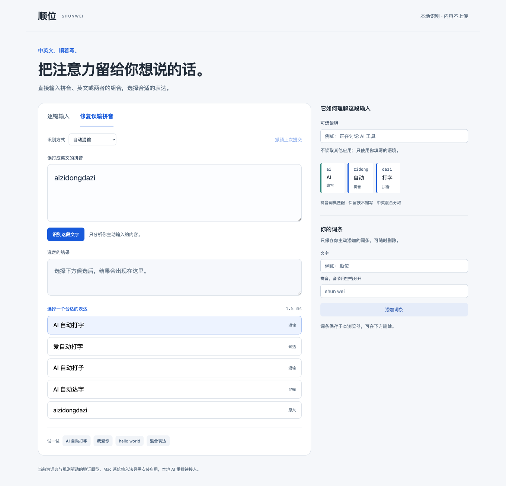

# 顺位输入法 · Shunwei IME

中英文，顺着写。一个探索**拼音、英文和技术缩写混合输入**的本地输入法项目，包含网页原型、macOS InputMethodKit 输入法和 Windows TSF 输入法开发版。

例如输入 `aizidongdazi`，可在候选中选择 **AI 自动打字**，同时保留“爱自动打字”和原文。面对 `ai`、`can` 等歧义，用户仍可以主动选词和原文提交。

**当前版本：v0.2.0-dev，开发预览版。默认拼音（中文优先），主要采用规则、词典和启发式排序；神经 AI 模型尚未接入。**

[下载安装包](https://github.com/alias508508-sys/shunwei-ime/releases/tag/v0.2.0-dev) · [使用与开发文档](docs/index.md) · [反馈问题](https://github.com/alias508508-sys/shunwei-ime/issues) · [项目进展](docs/history/项目工作回顾.md)



## 下载和安装

| 平台 | 下载 | 当前状态 |
|---|---|---|
| Mac（Apple Silicon） | [DMG 安装包](https://github.com/alias508508-sys/shunwei-ime/releases/download/v0.2.0-dev/Shunwei-0.2.0-dev-macOS-arm64.dmg) | 本机编译、签名完整性、服务启动和磁盘镜像检查通过；真实宿主打字尚未全面验收 |
| Windows 10/11 x64 | [EXE 安装包](https://github.com/alias508508-sys/shunwei-ime/releases/download/v0.2.0-dev/Shunwei-0.2.0-dev-Windows-Setup.exe) | 包含 x64/x86 TSF 组件；首发包在 Mac 交叉编译，尚未完成 Windows 实机安装及宿主输入验收 |
| 完整项目源码 | [源码 ZIP](https://github.com/alias508508-sys/shunwei-ime/releases/download/v0.2.0-dev/Shunwei-0.2.0-dev-GitHub-source.zip) | 含前期方案、网页、Mac/Windows 源码、词库、测试及构建脚本 |
| 文件校验 | [SHA-256 清单](https://github.com/alias508508-sys/shunwei-ime/releases/download/v0.2.0-dev/SHA256SUMS.txt) | 用于核对下载的安装包和源码包 |

Mac：打开 DMG，双击“安装顺位输入法.app”，再到**系统设置 → 键盘 → 文本输入**添加“顺位输入法”。安装程序不自动切换当前输入法。

Windows：运行安装器，在中文语言的键盘选项中添加“顺位输入法（开发版）”，再用 Win+空格切换。详细步骤见 [Mac 说明](docs/mac-install.md) 和 [Windows 说明](docs/windows-install.md)。

开发包没有 Apple Developer ID 公证或 Windows Authenticode 正式签名，系统可能提示发布者未经验证。建议先在测试环境使用，并保留系统自带输入法。

## 已有能力

- 拼音、英文、技术缩写的联合分段与候选排序，保留原文出口。
- 默认拼音（中文优先），网页和 Mac 可手动选择自动混输或英文锁定；Windows 首版采用中文优先策略。
- 组合输入、候选选择、原文提交和取消；网页另提供主动粘贴的整串误输修复。
- 网址、邮箱、路径等原文保护；Windows 当前对含技术标记的整串采取更保守的原文回退。
- 网页和 Mac 支持主动添加用户词条，分别在各自本地保存，不自动同步。
- Mac 和网页共享 TypeScript 解码核心（Mac 通过 JavaScriptCore 调用）；Windows 使用同源词典的原生 C++ 解码，候选排序不保证逐项相同。
- 不上传打字内容，不使用全局键盘监听。源码中的 GitHub 构建配置不会改变输入法的本地处理方式。

## 操作约定

| 按键 | 行为 |
|---|---|
| 空格 | 确认当前候选 |
| Return | 提交原始字母串 |
| Esc | 取消当前组合 |
| 上下方向键 | 选择候选 |
| 左右方向键 | 编辑组合区光标 |

歧义并不能仅靠拼音规范唯一判定；词频、语境或候选排序仍可能出错。示例不代表所有句子的识别准确率。

## 本地运行网页

需要 Node.js 24 和 npm：

```bash
npm ci
npm run dev -- --port 4173 --strictPort
```

打开终端打印的本地地址。在“逐键输入”中使用系统英文键盘体验，在“修复误输拼音”中可主动输入或粘贴整串内容。网页只处理自己的输入区，不能接管其他应用。

## 开发、测试和构建

```bash
npm test
npm run validate-data
npm run build
```

Mac 需要 Apple Silicon、Xcode 与系统 SDK：

```bash
npm run build:mac
npm run package:mac
```

Windows 可通过 Visual Studio/Windows SDK 构建 `windows/CMakeLists.txt`，分别选择 x64 和 Win32。Mac 交叉构建需要 LLVM-MinGW 20261006 和 NSIS，设置 `SHUNWEI_MINGW_ROOT` 后：

```bash
npm run build:windows:cross
npm run package:windows
```

[GitHub Actions](.github/workflows/build.yml) 支持手动触发和版本标签构建。具体运行结果以仓库 **Actions** 页面为准，不以“存在配置文件”作为 CI 通过的证据。

浏览器交互检查使用 Playwright CLI：

```bash
npx --package @playwright/cli playwright-cli open http://127.0.0.1:4173 --headed
npx --package @playwright/cli playwright-cli run-code --filename tests/browser-flow.js
```

构建文件放在各平台 `build/` 目录，发行文件放在 `releases/`，均不纳入源码历史。公开下载的安装包放在 GitHub Releases。

## 验证与限制

本地历史记录包括：37 项 TypeScript 核心测试、17 条浏览器路径、13 组 JavaScriptCore 一致性检查、14 项 Mac 组合协调器协议检查、12 项 C++ 可移植解码检查，以及 DMG 与 Windows PE 静态检查。历史测试日期和适用环境见[验证记录](docs/发行版验证_20261020.md)，不等于所有平台和宿主均可用。

Mac 已在当前开发机器的系统输入源枚举中被识别；TextEdit、浏览器、办公软件的真实输入、候选窗和失焦兼容性仍需验证。Windows 首发安装包尚未在 Windows 实机验证。没有大规模独立意图集，暂不宣称总体准确率。

超过 256 个 UTF-16 单位的整串输入先原文回退。Windows 首版暂未实现带调拼音、ü 快捷编码、用户词条管理和已提交文本恢复。Intel Mac、Windows ARM 原生构建、本地神经模型和小学拼音课程不在本版完成范围内。

## 文档、数据与后续方向

[文档总览](docs/index.md) 包含前期设计、开发交接、架构、安装、验证和发布记录。

当前含 90,149 条中文词/读音、117,493 个英文词形、432 个词库观测音节。来源为 CC-CEDICT、jieba、cmudict 等，原始数据、处理脚本和校验哈希均保留。音节表尚未完成规范教学审核，不能当作已审核的小学题库。

第三方许可见 [THIRD_PARTY_NOTICES](docs/THIRD_PARTY_NOTICES.md)。原创代码目前尚未指定开源许可证；仓库公开用于展示、阅读和反馈，不将第三方数据的许可替换为应用层许可。

接下来的重点是：真实系统输入测试、独立意图验收集、候选排序改进、本地 AI 重排评估，以及经过规范审核后的拼音学习模块。欢迎通过 Issues 提交复现步骤、系统版本和实际/期望结果，请勿粘贴密码或真实私人输入内容。
