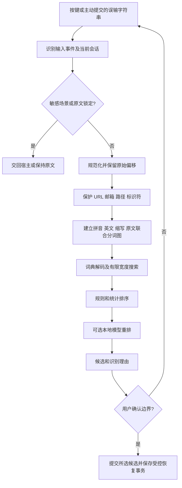

> 历史存档：记录2026-10-09的设计与交接状态，项目当时的模型、实现情况和路径不代表当前状态。个人机器绝对路径已转为相对说明；原始文件另行保留。

# 智能中英混输输入法：开发框架与实施细则

版本：v1.0｜日期：2026-10-09｜首发平台：macOS＋网页验证原型

状态：开发设计文档；尚未实现、编译或安装输入法。用户已选择先交付文档，再自行切换 GPT-6.1-sol 开发。本文性能与准确率数字均为拟定验收目标，不是实测结果。

## 1. 产品定位与成功标准

### 1.1 要解决的问题

用户连续输入字母时，经常忘记当前是中文还是英文模式，导致整串拼音以英文提交，或需要英文时被转成中文。产品应减少手动切换和重复输入，让用户直接输入，系统同时考虑中文拼音、英文、缩写和混合表达。

核心例子：`aizidongdazi` 在 AI 工具语境下，优先候选为“AI 自动打字”；其他候选可以包含“爱自动打字”和原文。用户写出的 `aizidongdazi.` 末尾句点应单独处理，不能丢失；首版默认保留 `.`，中文标点映射作为显式设置。

同一字符串并不总有唯一意图。仅凭合法拼音规则无法判断 `ai` 是“爱”还是 AI，也不能把 `can` 一律转换成“餐”。产品承诺是减少切换、提供可靠候选和容易恢复的操作，不承诺百分之百读懂意图。

### 1.2 产品形态

建立一个同时输出中英文候选的输入法，不通过反复切换现有的系统中文/英文输入源实现。用户只需一次启用本输入法，之后在同一组合输入区里完成混输。

交付两种界面，共享解码接口与测试数据：

1. 网页原型：用于观察输入、分词、候选与撤销；仅作用于网页自己的输入区，不接管其他应用。
2. macOS 输入法：接入 InputMethodKit，在支持的应用文本框内进行组合输入、候选选择和上屏。

后续小学拼音学习应用复用规范数据库和词语读音，但采用独立教学界面与评分逻辑。

### 1.3 首版范围

必须具备：连续全拼、英文保留、中英混合候选、原样提交、手动选择、组合区编辑、会话内原文恢复、离线基本输入、可解释的识别理由、用户词条增删、核心测试和 Mac 安装卸载说明。

暂不纳入：语音输入、手写输入、全平台发布、任意应用已提交全文自动重写、云端同步、自动生成小学教材、拼音学习正式课程、无依据的语音发音评分。

识别策略采用“规则＋词典＋统计排序”起步；验证有效后再接入本地模型。不能把几条硬编码字符串替换称为完整 AI 输入法，也不能把网页演示称为系统输入法已完成。

## 2. 用户操作与交互逻辑

### 2.1 基本操作

| 输入/操作 | 默认行为 |
|---|---|
| 输入字母 | 更新未提交组合区，并同时生成中文、英文、混合候选 |
| 空格 | 有组合区时选择当前候选；无组合区时输入空格 |
| Return | 有组合区时原样提交字母串；无组合区时交由应用处理换行 |
| 上下方向键 | 在候选中移动；无候选时交给宿主 |
| 鼠标点击候选 | 提交该候选，保留来源和原始拼音供受控恢复 |
| Esc | 取消当前组合，不删除先前已经提交的正文 |
| Backspace | 删除组合区中的一个编辑单元；空组合时交给宿主 |
| 标点 | 作为明确边界；允许提交当前候选后附加标点，原始字符仍可恢复 |
| 手动英文锁定 | 本次锁定期间原样输入，明确显示状态；用户解除后恢复自动模式 |
| 临时强制中文 | 提升中文候选优先级，仍保留原文出口 |

不要把停顿直接当成上屏信号。停顿只允许后台更新候选，避免用户思考或打字较慢时误提交。候选在用户开始导航后冻结，直到新的编辑输入，避免异步排序导致选错。

首版不使用数字键选词，以免与带调拼音、版本号和数字混输争抢按键；后续可设计明确的快捷键方案。

### 2.2 恢复策略

组合输入期间的撤销应恢复上一次缓冲区状态，不能依赖全局模拟按键。

Mac 已上屏内容的恢复需要记录本次提交的宿主、范围、文本和原始字母串。只有宿主支持范围读取/替换，且当前文本、选区、焦点仍匹配时，才允许恢复刚提交的一次内容。条件不满足时显示原文供用户选择，不盲目发送退格。不得拦截宿主通用撤销键破坏它的编辑历史。

网页原型可完整实现自己的事务撤销；不能据此宣称所有 Mac 应用都支持相同恢复能力。

### 2.3 关键体验

- `aizidongdazi`：在 AI 语境下展示“AI 自动打字”，标注分段 `ai | zi dong | da zi`；保留中文与原文备选。
- `woaini`：中文候选包含“我爱你”，同时可以 Return 提交原文。
- `hello`：英文优先，避免为了中文覆盖强行分音节。
- `can`：英文候选和合理中文候选共存；无上下文时不自动消灭歧义。
- `wo yong python xie daima`：候选包含“我用 Python 写代码”；空格作为粘贴分析输入边界时保留偏移映射。真实逐键输入的空格是确认键，两种入口必须区分。
- URL、邮箱、路径、代码标识符：识别为受保护原文片段，原则上不转换。

网页提供“逐键输入体验”和“整串误输修复”两个入口。后者由用户主动粘贴/输入并点击分析，不读取剪贴板历史。

## 3. 拼音规范与知识数据

### 3.1 两套表示

规范层服务于教学和合法音节校验；键盘层服务于快捷输入。二者不能混为一谈。例如键盘输入 `v`、`u:` 可映射到 `ü`，教学显示应采用规范拼写，不把 `v` 教成汉语拼音字母。

规范依据采用教育部《汉语拼音方案》，词语拼写参考《汉语拼音正词法基本规则》公开文本。课程上线前还需核对标准有效状态、现行教材口径与适用年级。

### 3.2 数据覆盖清单

- 声母、韵母、零声母音节、整体认读音节的教学分类与规范拼写映射。
- `zh/ch/sh` 等多字母单位，以及 `y/w` 相关拼写变化。
- `ü` 和 `j/q/x`、`n/l` 等的拼写处理，键盘别名与标准形式分离。
- `iou/uei/uen` 的缩写规则与适用条件；不得不分环境全局替换。
- 四声、轻声、调号位置；数字声调输入只在教学/专用解析入口默认启用。
- 隔音符号，如 `xi'an` 与 `xian`，保留不同解析路径。
- 儿化与独立 `er` 的区分，先支持明确词条，不靠任意后缀规则推测。
- 多音字按词和语境记录读音；不能由单字表直接拼接出唯一正确词音。
- 标准拼写、口语变调、输入容错分层存储；教学答案不得静默接受成人输入法的模糊拼音。
- 边缘音节、方言、语气词单独登记来源和适用域，不宣称仅靠声母韵母笛卡尔积覆盖所有合法音节。

### 3.3 数据结构与来源追踪

```ts
interface SyllableEntry {
  id: string;
  canonical: string;
  keyboardAliases: string[];
  initial: string | null;
  final: string;
  sourceId: string;
  reviewStatus: 'verified' | 'pending';
}
interface LexiconEntry {
  text: string;
  syllables: string[];
  tones?: number[];
  frequency?: number;
  domain?: string;
  sourceId: string;
}
```

单独维护 `sources.json`：记录来源 URL、版本、获取日期、许可证、允许用途、校验哈希和人工审核状态。引擎许可证不等于词库许可证，分别确认。未经审核的教学条目不进入正式题库。

开发时自动检测重复音节、非法别名、缺失来源、调号与音节不一致、词条无法分词等问题。规范条目审核覆盖率要求 100%；“全部拼音规范已覆盖”只能在完整清单逐项审核后声称。

## 4. 核心识别算法

### 4.1 总流程



### 4.2 为什么使用联合分词

不要先判断整串是中文或英文，再交给单一解码器。`aizidongdazi` 的开头可能是英文缩写 AI，后面是中文；整串二分类会漏掉这个目标。

对每个位置建立可能的边：合法拼音音节、英文词、已知缩写、受保护片段、原文回退。用动态规划或 beam search 搜索多条路径，再通过词典把连续拼音转换成汉字词组。

必须保留多个切分，不采用不可回退的最长匹配。对拼音词段生成 N-best 中文候选后，与英文片段拼接并去重。未知字母串必须有原文路径，不得消失。

### 4.3 排序依据

```text
score = 中文词频/语言模型分
      + 英文词频/语言模型分
      + 上下文兼容度
      + 用户明确选择形成的本地偏好
      - 中英文切换惩罚
      - 拼写修正成本
      - 不必要的转换成本
```

权重是需要验证集调优的参数，不是语言规则。英文词典命中只是特征，不意味着必须屏蔽中文路径。缩写表中的 AI 也不应无条件胜过“爱”。

界面先显示“中文倾向/英文倾向/有歧义”等解释，不把启发式分数伪装成概率。只有使用独立校准集验证过的模型输出才能称为置信概率。低置信候选不自动替用户提交。

### 4.4 AI 的职责和边界

第一阶段以规则、真实词典、统计排序形成可验证基线。第二阶段再将本地小模型接到候选重排接口，比较它是否真正减少误转换。模型只能选择或重排合法候选；自由生成的改写不进入默认输入路径。

默认无网络输入，模型推理超时即保留基线候选。云模型如需实验，必须单独显式启用，只发送允许的最小上下文，不上传密码、受保护字段或全局键盘流。商业发布前再单独进行相应数据合规评估。

### 4.5 性能与异步一致性

暂定：最多分析 256 个字符，beam width 起点为 16，每段最多保留 8 个解码候选，界面最多显示 5 个。更长输入按边界分段，任何剩余片段原样保留。参数必须依据性能结果调整。

每次编辑递增 `revision`；后台结果携带 `sessionId + revision`，仅当前会话当前版本可更新候选。焦点切换、取消、提交、锁定状态改变时取消或废弃旧任务。任何过期模型结果都不得替换新输入。

不要等待 AI 才显示按键。基线候选立即可用，本地模型重排设软截止；过期结果丢弃，并避免候选列表在用户操作时跳动。

## 5. 技术架构与项目组织

### 5.1 技术选择

- 网页原型：TypeScript＋Vite，界面规模较小时使用原生 DOM 即可，不为演示引入复杂状态框架。
- 核心接口：与 UI 分离，先用 TypeScript 验证联合分词和排序；数据文件采用可移植 JSON/TSV。
- macOS：Swift＋AppKit/InputMethodKit；中文解码优先评估 librime 的 C API，经薄桥接层调用。
- 共享方式：原型与 Mac 首先共享数据、输入输出协议和 golden fixtures；不宣称 Swift 与 TypeScript 自动共享同一份运行时代码。
- 若后续双端长期维护成本显著，再评估抽取 Rust/C++ 核心并输出原生库和 WebAssembly；不在首轮就搭建多语言基础设施。
- 存储：小规模用户词条和设置采用本地文件；确有检索与并发需求时再引入 SQLite。

librime 是中文解码引擎候选，不自动解决混合片段识别和教学规则。第一项技术试验应验证它输出的候选/分段信息是否足够支持联合解码；若接口不能提供所需分段，显式在上层枚举边界，不依赖不存在的接口。

### 5.2 建议目录

```text
smart-ime/
  README.md
  docs/
    architecture.md
    acceptance.md
    sources.json
    status.md
  data/
    pinyin-syllables.json
    english-lexicon.tsv
    abbreviations.json
    chinese-lexicon.tsv
  web/
    src/core/normalizer.ts
    src/core/protected-spans.ts
    src/core/lattice.ts
    src/core/decoder.ts
    src/core/ranker.ts
    src/core/session.ts
    src/ui/
  macos/
    SmartIME.xcodeproj/
    SmartIME/InputController.swift
    SmartIME/CandidatePanel.swift
    SmartIME/EngineBridge/
  tests/
    fixtures/
    core/
    integration/
  scripts/
    validate-data.*
```

目录只在需要对应实现时建立，不创建空壳工程冒充功能完成。

### 5.3 跨端接口约定

```ts
type InputMode = 'auto' | 'english' | 'chinese';
interface DecodeRequest {
  sessionId: string;
  revision: number;
  raw: string;
  cursor: number;
  mode: InputMode;
  context?: string; // 已获允许的短上下文；缺失时正常工作
}
interface Segment {
  start: number;
  end: number; // 原始输入的 UTF-16 半开区间
  kind: 'pinyin' | 'english' | 'abbreviation' | 'literal';
  output: string;
}
interface Candidate {
  id: string;
  text: string;
  segments: Segment[];
  score: number; // 排序分，不是概率
  reason: string[];
}
interface DecodeResult {
  sessionId: string;
  revision: number;
  candidates: Candidate[];
  rawFallback: string;
}
```

UTF-16 偏移方便与网页及 macOS NSRange 对接；Swift String 不能直接把整数当字符索引，必须显式转换和验证。光标编辑以完整字符边界为单位；归一化后的偏移必须映射回原串，尤其考虑声调组合字符和 emoji。

## 6. 状态机与 Mac 实现细则

状态：`idle → composing → choosing → committed → idle`；`cancel` 回到 idle，`focusLost` 根据明确策略完成或取消组合。语言锁定属于会话属性，不需要复制整个状态机。

### 6.1 系统集成任务

1. 创建真正的 InputMethodKit 输入法 target，配置 bundle、连接名、控制器与 Info.plist；具体键值参照当前 SDK 文档和可运行最小实例验证，不能从旧博客照抄。
2. 在独立最小样例中验证激活、接收字母、marked text、候选定位、insertText、取消、停用和焦点切换。
3. 接入解码桥接层；为每个客户端维护独立 session，不能把一个窗口的上下文带到另一个窗口。
4. 组合区左/右方向键进行光标编辑；选区替换先更新缓冲区再解码；无组合区的快捷键交回宿主。
5. Command/Control 快捷键、死键、非拉丁输入、系统特殊键不得吞掉；为不同 modifier 组合编写路由测试。
6. 候选窗跟随插入点，处理多显示器缩放、窗口边缘、失焦和宿主不提供有效坐标的降级。
7. 敏感/安全输入场景以系统和宿主可见能力为界，不承诺能检测所有密码框；上下文不可用时不读取、不学习。始终禁止全局键盘监听与密码学习。
8. 提供本地构建、用户级安装、启用、停用和卸载说明。启用需要用户在系统设置中选择；签名、公证、分发资格和兼容版本在发布阶段核验。

### 6.2 焦点和异常行为

- 焦点变化后绝不向旧客户端提交延迟候选。
- 会话关闭取消后台任务并清空短上下文。
- 解码错误保持原文候选，UI 不崩溃、不丢字。
- 系统不提供预期文本能力时降级，不通过全局辅助功能权限绕过宿主边界。
- 原型里可以显式显示“当前英文/拼音/混合倾向”，但 Mac 不应每输入一个字母就切系统输入源。

### 6.3 网页特有处理

必须正确处理 `compositionstart/update/end` 和 `beforeinput/input`，避免用户使用现有中文输入法时被二次转换。逐键体验建议切到系统英文键盘；已经输入的中文直接保留。粘贴、选区替换、撤销、移动光标分别测试。

## 7. 隐私与用户词条

默认离线，不记录整段输入历史，不采集全局按键，不建立跨应用画像。用户词条只保存明确添加或明确允许学习的词，提供列表、删除和清空入口。调试日志只保存耗时、错误类型、版本等结构信息，不默认写入原始文本。

上下文默认限本次组合和用户允许的短邻近文本；无法获取时正常候选输入仍可工作。网页原型无后端即可运行，若持久化用户词条必须说明存储位置并支持删除。

## 8. 拼音学习模式：第二阶段独立产品模块

定位：面向小学生的音节拼读与规范书写练习，而不是以成人输入法纠错代替教学。

建议学习顺序：听辨与字母认识 → 声母韵母 → 拼合音节 → 声调与标调 → 易混音节 → 常用词拼写。具体顺序按年级教材由教师审核。

题型：听音选拼音、拼音配图、声韵拼合、标调、`ü` 规则、隔音符号、错题回练。先做文本/选择题与人工审核音频，不在首版声称自动测出口音或发音准确率。

输入法允许 `lv` 输入“绿”，教学界面应说明对应 `lǜ`，不能把快捷键编码判为标准拼写正确答案。多音字必须提供语境；“一、不”等变调需要区分拼写形式与实际发音说明，并提供审核来源。

每道题保存知识点、适用年级、标准答案、允许变体、解释、来源和审核人。AI 可辅助生成草稿，未经教师审核不得进入正式题库。儿童学习记录独立于成人输入法历史，首版采用无账号本地模式。

## 9. 分阶段开发任务与完成条件

### P0：技术可行性验证

任务：验证 InputMethodKit 最小输入法；评估 librime 候选 API；确认规范音节表和词库来源；冻结接口与关键测试集。

完成条件：至少一个本机编辑器能够输入、组合、选择、取消；网页与 Mac 的同一 fixture 可以描述一致结果；安装/卸载步骤可复现；来源未确认项清晰标记。

### P1：网页 MVP

任务：实现真实数据驱动的联合分词、英文保护、候选、原文提交、编辑、撤销和整串修复入口。数据覆盖范围明确列出，不用示例映射假装通用解码。

完成条件：本地命令启动成功；核心和交互测试通过；没有输入丢失；`aizidongdazi` 的目标结果来自一般分词/词典逻辑，而非整串特殊判断；README 有运行说明。

### P2：Mac 内测版

任务：接入中文引擎与排序逻辑；实现 marked text、候选窗口和受限恢复；完成用户设置与词条管理。

完成条件：在 TextEdit、一个浏览器文本框和一个办公编辑器逐项记录实测；缺少的应用写“未测”，不以模拟器或网页代替；快速切焦点没有串字；安装和卸载可重复执行。

### P3：本地 AI 重排

任务：确定候选重排模型、体积、硬件最低要求与许可证；建立人工标注意图集；对比规则基线。

完成条件：保留集上减少误转换，且满足延迟门槛；失败/超时/离线不影响输入；如模型收益不足，保留基线而不是强行上线 AI。

### P4：拼音学习试验版

任务：教师审核的有限题库、拼音说明、离线练习和错题复习。

完成条件：每题有来源与审核，输入编码和教学规则分离；先小范围试用再扩充，不能用输入法词频判断儿童学习正确性。

不预设未经估算的完工日期。每阶段结束记录实际耗时、阻塞和剩余任务，再估计下一阶段。

## 10. 验收测试与指标

### 10.1 必测场景

| 输入/事件 | 应验收的性质 |
|---|---|
| `aizidongdazi`，AI 工具语境 | Top-3 含“AI 自动打字”；原文保留；混合片段定位正确 |
| `aizidongdazi.` | 目标候选与句点保留；不丢字符 |
| `ai`，无上下文 | 英文/中文有歧义提示，不能假称唯一答案 |
| `woaini` | 含“我爱你”；可原文提交 |
| `can` / `an` / `shi` | 保留歧义候选；不因短串强制改写 |
| `hello world`，整串入口 | 英文、空格完整保留 |
| `wo yong python xie daima`，整串入口 | 有合理混输候选，源区间覆盖完整 |
| `https://example.com/a` / `a@example.com` | 原样保留 |
| `foo_bar` / `v1.2.3` / 文件路径 | 原样保护；不能把数字当声调吞掉 |
| `xi'an` / `xian` | 隔音符号影响解析，原始输入可恢复 |
| `lv` / `lǜ` | 对应关系可解释；教学显示规范形式 |
| `zh` 等未完音节 | 正常等待，不提前提交，不报错 |
| 未知串、emoji、中文夹字母 | 未知部分保留，不崩溃 |
| 中间插字、选区替换、粘贴 | 光标位置与内容正确，无重复处理 |
| 快速输入＋慢模型返回 | 旧 revision 被丢弃，不能覆盖新内容 |
| 候选导航后异步返回 | 不替换用户正在选择的候选 |
| 失焦/切应用/取消组合 | 不向错误窗口上屏 |
| 解码失败、词库缺失 | 原文回退和明确状态，不静默丢字 |
| 安全输入、上下文不可读 | 不学习、不上传，不影响宿主安全输入 |
| 撤销不满足范围条件 | 不盲删已提交文本 |

测试不应只断言硬编码示例。增加未用于开发的中文、英文、缩写混输与歧义样本，按使用者意图标注。多义样本允许多个正确答案，另行报告不能确定的比例。

### 10.2 拟定门槛

- 首个基线候选刷新 P95 ≤ 30ms；本地模型重排 P95 ≤ 100ms。记录具体设备、系统、词库、冷/热启动条件；UI 不等待模型。
- 受保护串测试集完整保留率 100%；输入编辑/取消/提交往返测试无丢字。
- 独立验收集至少 300 条，均衡覆盖中文、英文、混输、歧义及保护串；与开发/调参集分离。
- 混输 Top-3 意图命中率目标 ≥ 95%，纯英文错误优先转换率目标 ≤ 1%；样本较小时只作内测门槛，不推断总体准确率。
- 同时统计 Top-1、Top-3、平均选词次数、每百字模式切换次数、原文恢复次数和任务完成时间。
- AI 阶段在固定保留集上与基线配对比较；至少不降低原文保护和字符保全结果。

### 10.3 验证顺序

数据校验 → 核心单元测试 → 组合编辑与异步测试 → 网页真实浏览器操作 → Mac 宿主兼容性实测 → 延迟测量 → 用户任务试用。

所有报告分开列“已通过”“失败”“未测”。构建成功不等于安装成功，安装成功不等于跨应用可用。

## 11. 开发时必须遵守的细则

1. 先读取工作目录的 AGENTS.md 和适用技能，再检查工具链；保留本方案和现有文件。
2. 每次改动对应明确需求；先解决关键输入路径，避免无关重构。
3. 固定依赖版本并保留 lockfile；核对引擎、词库、模型各自许可证。
4. URL、邮箱等保护检测先于拼音容错；容错不得改变受保护片段。
5. 不用全局键盘记录工具实现输入法，不静默改系统输入源或安全设置。
6. 提交、取消、失焦、撤销均通过同一 session 模块，避免各界面重复实现相互冲突的逻辑。
7. 核心测试以性质和真实用户场景为主；测试必须发现丢字、误转换和串会话，而非只复刻函数实现。
8. 文档声明与实际一致；缺数据、未接模型、未完成系统接入时明确展示。
9. 若需要用户在系统设置启用输入法，应先完成可安装构建和具体操作说明，再请求用户操作。
10. 产出 README、测试报告、已知限制、安装卸载说明及版本记录。

## 12. 官方资料与待核对事项

查阅日期：2026-10-09。以下是技术/规范依据，不代表本项目已完成实现或取得发布资格。

- [Apple InputMethodKit](https://developer.apple.com/documentation/inputmethodkit)：Mac 原生输入法接口依据。
- [librime 核心引擎](https://github.com/rime/librime) 与 [C API](https://github.com/rime/librime/blob/master/src/rime_api.h)：评估中文解码集成。
- [librime LICENSE](https://github.com/rime/librime/blob/master/LICENSE)：引擎 BSD 三条款；词库和依赖另核。
- [教育部《汉语拼音方案》](https://www.moe.gov.cn/jyb_sjzl/ziliao/A19/195802/t19580201_186000.html)：规范层起点。
- [教育部公开《汉语拼音正词法基本规则》GB/T 16159—2012](https://www.moe.gov.cn/ewebeditor/uploadfile/2015/01/13/20150113091717604.pdf)：词语拼写参考文本；正式教学发布前复核有效状态。
- [Android 输入法开发](https://developer.android.com/develop/ui/views/touch-and-input/creating-input-method)：未来移动端路线参考，本期不开发。
- [Microsoft TSF](https://learn.microsoft.com/en-us/windows/desktop/TSF/text-services-framework)：未来 Windows 路线参考，本期不开发。
- [Apple 自定义键盘限制](https://developer.apple.com/documentation/uikit/configuring-a-custom-keyboard-interface)：iOS 与 Mac 不同，安全输入框等有额外限制，不承诺统一移植。

待核对：目标 macOS 版本和芯片；Xcode/SDK 可用性；实际可再分发中文词库；目标编辑器兼容性；本地模型收益及许可证；教学规范有效状态和年级适配。

这些事项不阻止先建立网页原型、核心测试与 Mac 最小接入样例，但会影响正式发布边界。
